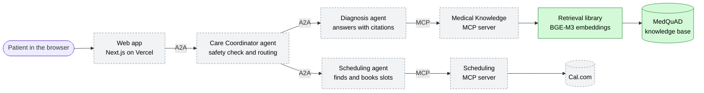
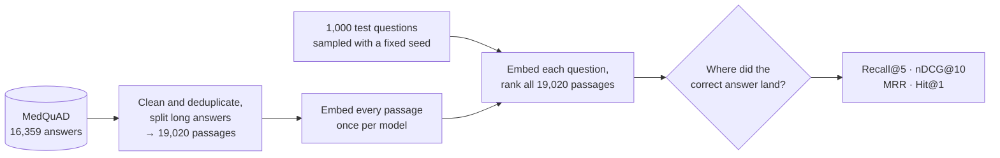
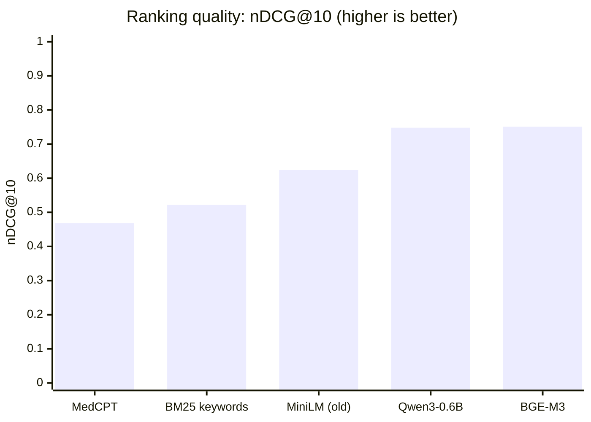
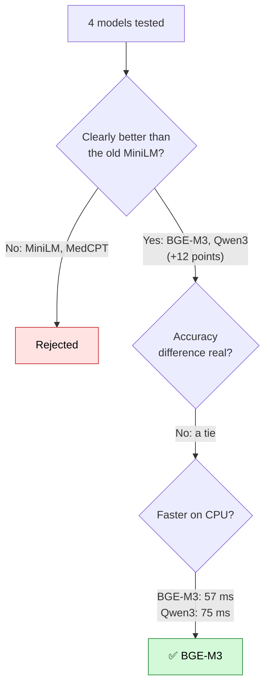
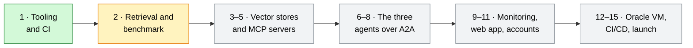

# RAGMed

[](https://github.com/BijanProjects/RAGMed/actions/workflows/ci.yml)

RAGMed is a multi-agent clinical triage assistant. A patient describes their symptoms and gets an
answer grounded in a curated medical knowledge base, with citations. When a visit is warranted, the
system offers real appointment slots and books one after the patient confirms.

> **Status:** active rebuild. The retrieval layer (finding the right medical passage for a question)
> is built and benchmarked. The agents, the web app and the deployment come next. See the
> [roadmap](#roadmap).

**Contents:** [Try it](#try-it-locally) · [How it fits together](#how-it-fits-together) ·
[Project structure](#project-structure) · [Embedding benchmark](#embedding-benchmark) ·
[Roadmap](#roadmap)

## Try it locally

You need Python 3.12 and about 3 GB of disk space for the models.

```bash
cd backend
make install          # create .venv, install locked dependencies and git hooks
make check            # lint, strict type check, 80+ tests: should end with "passed"
make install-bench    # add PyTorch and the embedding models' libraries (~1 GB)

make search Q="What are the symptoms of asthma?"
```

The first search downloads BGE-M3 (2.3 GB) and embeds the whole knowledge base once (about 10
minutes on an Apple Silicon GPU). After that, each question takes about 60 ms on CPU:

```text
Q: my child has a rash and high fever
   BAAI/bge-m3 on cpu: 59 ms
  1. [0.602] susceptibility | Who is at risk for?
      Measles: Make Sure Your Child Is Protected with MMR Vaccine Measles starts with a fever...
  2. [0.587] information | What is (are) Respiratory Syncytial Virus Infections?
  3. [0.582] information | What is (are) Fifth Disease?
```

## How it fits together

This is the target system. Green parts exist today; the rest is planned.



Three ideas carry the whole design:

- **RAG** (retrieval-augmented generation): before answering, the system *retrieves* the passages
  that best match the question and the language model answers using only those, citing them. How
  well retrieval works sets an upper limit on answer quality, which is why it was built and
  measured first.
- **A2A** (Agent2Agent protocol): each agent is its own web service. Agents talk to each other only
  through A2A messages, never by importing each other's code.
- **MCP** (Model Context Protocol): agents never touch a database or an outside API directly. They
  call a small, fixed set of tools on an MCP server, which limits what an agent can do.

## Project structure

The repository is split by language: **everything Python is in `backend/`**, everything
TypeScript will be in `frontend/`. Inside `backend/`, code is split into *packages* (libraries
that do nothing on their own) and *services* (programs you run, such as an agent or an MCP
server). Services import packages; packages never import services.

```text
RAGMed/
├─ backend/                          ALL PYTHON CODE
│  ├─ packages/                      libraries, each with its own tests/
│  │  ├─ ragmed_core/                settings, JSON logging, trace ids (shared by every service)
│  │  └─ ragmed_retrieval/           load MedQuAD, chunk, embed, search, benchmark  ◀ the work so far
│  ├─ services/                      runnable programs: MCP servers and agents (next phases)
│  ├─ evals/                         the embedding benchmark
│  │  ├─ data/                       1,000 frozen test questions
│  │  ├─ results/                    one JSON file per model and pipeline
│  │  ├─ analysis/                   confidence intervals, scores per question type
│  │  └─ analysis.py                 the script that produces analysis/
│  ├─ data/raw/medquad.csv           the knowledge base (input, never modified)
│  ├─ data/artifacts/                generated embeddings (git-ignored, rebuilt on demand)
│  ├─ legacy/                        the original FAISS + Llama prototype, kept for reference
│  ├─ requirements/                  *.in = what we want, *.txt = exact pinned versions
│  ├─ pyproject.toml                 ruff, mypy and pytest settings
│  └─ Makefile                       every command: make help
├─ frontend/                         Next.js web app (not started yet)
├─ .github/workflows/ci.yml          lint, type-check and test on every pull request
└─ README.md                         this file
```

### Where do I look for…

| I want to… | Go to |
| --- | --- |
| See how a question finds its answer | [`ragmed_retrieval/cli.py`](backend/packages/ragmed_retrieval/src/ragmed_retrieval/cli.py) (`search`), then [`benchmark.py`](backend/packages/ragmed_retrieval/src/ragmed_retrieval/benchmark.py) |
| See how MedQuAD is cleaned and split into passages | [`corpus.py`](backend/packages/ragmed_retrieval/src/ragmed_retrieval/corpus.py), [`chunking.py`](backend/packages/ragmed_retrieval/src/ragmed_retrieval/chunking.py) |
| Change or add an embedding model | `MODEL_PRESETS` in [`cli.py`](backend/packages/ragmed_retrieval/src/ragmed_retrieval/cli.py), loaders in [`embedding.py`](backend/packages/ragmed_retrieval/src/ragmed_retrieval/embedding.py) |
| See how scores are computed | [`metrics.py`](backend/packages/ragmed_retrieval/src/ragmed_retrieval/metrics.py) |
| See keyword search and reranking | [`hybrid.py`](backend/packages/ragmed_retrieval/src/ragmed_retrieval/hybrid.py) |
| Read the raw benchmark numbers | [`backend/evals/results/`](backend/evals/results/) |
| Change settings, logging or tracing | [`ragmed_core/`](backend/packages/ragmed_core/src/ragmed_core/) |
| Find a command | `cd backend && make help` |
| Read about each module in more detail | [`backend/README.md`](backend/README.md) |

### Why not one folder per service at the top level?

An earlier plan put `apps/`, `services/` and `packages/` at the top of the repository. Grouping by
language instead keeps one Python toolchain (one virtual environment, one lint and type-check
configuration, one CI job) in one place, and lets the frontend be deployed from its own folder
on Vercel. The plan's folders map across one to one:

| Plan | This repository |
| --- | --- |
| `packages/ragmed_core`, `packages/ragmed_retrieval` | `backend/packages/…` |
| `services/coordinator_agent`, `diagnosis_agent`, `scheduling_agent`, `mcp_medical`, `mcp_scheduling` | `backend/services/…` (to be created) |
| `evals/` | `backend/evals/` |
| `apps/web` | `frontend/` |

## Embedding benchmark

An **embedding model** turns text into a list of numbers (a vector) so that texts with similar
meaning get similar vectors. Retrieval embeds the patient's question and returns the passages
whose vectors are closest. A better embedding model finds the right passage more often, so this
choice matters more than almost any other in a RAG system. Six candidates were planned; four were
run here.

### How the models were compared



- **The test set.** 1,000 MedQuAD questions, chosen at random with a fixed seed and saved in
  [`evals/data/`](backend/evals/data/), so every model gets exactly the same exam. Each question's
  correct result is the answer MedQuAD gives for it.
- **No shortcuts.** Only the answers are indexed, never the questions, so a model cannot win by
  matching a question to itself. It has to understand which passage answers it.
- **Same conditions for all.** Same passages, same questions, same scoring code, every model in
  full 32-bit precision.

### What the scores mean

| Metric | In plain words | Why we care |
| --- | --- | --- |
| **Recall@5** | How often the correct answer is somewhere in the top 5 | The top 5 passages are what the language model will read |
| **nDCG@10** (main score) | Ranking quality in the top 10. 1.0 = always first; an answer in 2nd place counts 0.63, in 3rd place 0.5 | One number that rewards ranking the answer high |
| **MRR** | Average of 1 ÷ (position of the first correct answer) | Like nDCG, without the cut-off at 10 |
| **Hit@1** | How often the very first result is correct | The strictest test |
| **Latency** | Time to embed one question on 4 CPU threads, like the Oracle server | The plan's rule: under 300 ms |

### Results



| Model | Size | Recall@5 | nDCG@10 | MRR | Hit@1 | Query time on CPU |
| --- | --- | ---: | ---: | ---: | ---: | ---: |
| **BGE-M3** ✅ chosen | 568M | **0.856** | **0.751** | **0.710** | **0.588** | 57 ms |
| Qwen3-Embedding-0.6B | 596M | 0.853 | 0.748 | 0.700 | 0.575 | 75 ms |
| MiniLM-L6 (previous model) | 23M | 0.757 | 0.624 | 0.565 | 0.418 | 4 ms |
| MedCPT (medical-specific) | 110M ×2 | 0.586 | 0.468 | 0.406 | 0.254 | not measured |
| *BM25 keyword search, no model* | — | 0.659 | 0.522 | 0.446 | 0.279 | — |

Query time is the median time to embed one question on 4 CPU threads of an Apple M4 Pro. The
Oracle server's cores are slower, so expect roughly 2–3× these numbers there; that will be
measured on the server itself. It is a small part of a request: generating the answer with the
language model takes seconds.

**Is a difference real, or luck?** A model can do slightly better on these particular 1,000
questions by chance. To check, the questions were resampled 10,000 times (a *paired bootstrap*)
and the gap recomputed each time. If the range that holds 95% of the gaps includes zero, the
difference could be luck. ([`evals/analysis.py`](backend/evals/analysis.py))

| Comparison (nDCG@10) | Gap | 95% range | Verdict |
| --- | ---: | --- | --- |
| BGE-M3 vs Qwen3-0.6B | +0.3 points | −1.3 to +1.8 | **Tie** |
| BGE-M3 vs MiniLM | +12.6 points | +10.6 to +14.6 | Real improvement |
| Qwen3-0.6B vs MiniLM | +12.4 points | +10.5 to +14.2 | Real improvement |
| MiniLM vs MedCPT | +15.6 points | +13.3 to +17.9 | Real |

### Adding keyword search made the good models worse

*Hybrid search* combines the embedding ranking with a classic keyword ranking (BM25) by
alternating between the two lists (Reciprocal Rank Fusion, equal weights). It is often
recommended, so it was tested rather than assumed:

| Model | Embeddings only | Hybrid | Change |
| --- | ---: | ---: | --- |
| BGE-M3 | 0.751 | 0.678 | 🔻 −7.3 points (real) |
| Qwen3-0.6B | 0.748 | 0.654 | 🔻 −9.4 points (real) |
| MiniLM | 0.624 | 0.622 | no change |
| MedCPT | 0.468 | 0.545 | 🔺 +7.7 points (real) |

Keyword search on its own scores 0.52 here. Mixing in a much weaker list drags strong models
down and only helps models weaker than it. MedQuAD answers repeat the same boilerplate across
thousands of diseases ("These resources address the diagnosis or management of…"), which
confuses keyword matching. **Decision: no hybrid search for now.** A weighted mix may be tried
later, tuned on separate questions so the test set stays untouched.

### Why the medical model came last

MedCPT was trained on PubMed search logs: short keyword queries matched to research abstracts.
MedQuAD is plain-language questions answered by consumer health pages, a different kind of text,
so being "medical" did not help. It did worst on symptom questions (0.29 against 0.91 for BGE-M3).

### Strengths by question type

BGE-M3 and Qwen3 tie overall but are good at different things (nDCG@10, six largest groups):

| Question type | Questions | BGE-M3 | Qwen3-0.6B | MiniLM |
| --- | ---: | ---: | ---: | ---: |
| "What is X?" | 260 | **0.863** | 0.756 | 0.700 |
| Symptoms | 182 | **0.911** | 0.902 | 0.661 |
| Treatment | 178 | 0.715 | **0.803** | 0.710 |
| Inheritance | 79 | 0.476 | **0.546** | 0.495 |
| Genetic changes | 61 | **0.529** | 0.418 | 0.239 |
| Frequency | 58 | **0.720** | 0.694 | 0.732 |

All question types: [`evals/analysis/significance.json`](backend/evals/analysis/significance.json).

### Decision: BGE-M3



BGE-M3 is as accurate as Qwen3 and about 25% faster on CPU, which matters because the server has
no GPU. It also has an MIT licence and supports more than 100 languages. It is now the default
model (`DEFAULT_MODEL` in [`cli.py`](backend/packages/ragmed_retrieval/src/ragmed_retrieval/cli.py)).

### Reranking: not decided yet

A *reranker* re-reads the top candidates together with the question and reorders them. It is
usually the biggest single accuracy gain in a RAG pipeline, but it is expensive. On 4 CPU threads:

| Reranker | Rerank 40 passages | Rerank 20 passages |
| --- | ---: | ---: |
| bge-reranker-v2-m3 (568M, same size class as Qwen3-Reranker-0.6B) | 6.9 s | 3.5 s |
| ms-marco-MiniLM-L6 cross-encoder (23M) | 0.7 s | — |

A 0.6B reranker is too slow for a CPU server. The options are a small reranker over fewer
passages, a reranking API, or no reranker; the next experiment measures how much accuracy each
adds on MedQuAD.

### Caveats

- **Scores are underestimates.** MedQuAD sometimes answers the same question twice, from two NIH
  sources, but only one counts as correct. Of BGE-M3's 412 wrong first results, 42 were the other
  source's answer to the identical question.
- **The test questions are not how patients talk.** MedQuAD asks "What are the symptoms of X?";
  a patient says "my chest has felt tight for three days". The agent will rewrite the conversation
  into a search query first, which narrows this gap. A small hand-written set of patient-style
  questions would make the test more realistic.
- **Not run yet:** EmbeddingGemma (needs a Hugging Face licence acceptance), the larger Qwen3 4B/8B
  models as an accuracy ceiling, and timing on the Oracle server itself.
- **Precision check:** Qwen3 was first run in bfloat16 by accident, then re-run in float32. The
  score moved by 0.1 points, so precision did not affect the comparison.

### Reproduce it

```bash
cd backend && make install-bench
python -m ragmed_retrieval benchmark --model bge-m3 --eval evals/data/medquad-eval-v1.jsonl
python -m ragmed_retrieval benchmark --model bge-m3 --eval evals/data/medquad-eval-v1.jsonl --hybrid
make report          # results table
make significance    # confidence intervals and per-question-type scores
```

Each model embeds 19,020 passages once (about 10–20 minutes on an Apple Silicon GPU); the vectors
are saved, so re-runs take seconds.

## Roadmap



- [x] Workspace, tooling and CI
- [ ] Ingestion pipeline and embedding benchmark *(nearly done: reranking and CPU speed-up left)*
- [ ] Vector store connectors with shared contract tests
- [ ] Medical Knowledge MCP server
- [ ] Scheduling MCP server (Cal.com)
- [ ] Diagnosis, Scheduling and Care Coordinator agents over A2A (Groq models)
- [ ] Observability and evaluation suite
- [ ] Web frontend
- [ ] Infrastructure as code and continuous deployment (Oracle Cloud Always Free VM)

## Data

[MedQuAD](https://github.com/abachaa/MedQuAD) (Ben Abacha & Demner-Fushman, 2019), distributed
via the [Comprehensive Medical Q&A Dataset](https://www.kaggle.com/datasets/thedevastator/comprehensive-medical-q-a-dataset)
on Kaggle, licensed CC BY 4.0.

## Disclaimer

RAGMed is an educational project. It is not a medical device and does not provide diagnoses. In an
emergency, contact your local emergency services.
