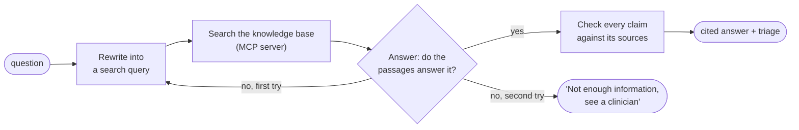

# Diagnosis agent

Answers a medical question using only RAGMed's knowledge base, cites its sources, and triages:
how urgent it is, whether to see a clinician, and which kind. It is served over
[A2A](https://a2a-protocol.org), so the Care Coordinator (or any A2A client) can call it.



## Safety rules enforced in code

These hold whatever the language model returns:

- **No medication doses.** Any sentence with a dose ("500 mg", "2.5 ml", "10 units") is removed.
- **Only real citations.** Citation numbers that do not match a retrieved passage are dropped.
- **Urgent means see someone.** `urgent` and `emergency` always set `recommend_visit`.
- **No answer means see someone.** When the sources do not answer the question, or checking
  removes the whole answer, the reply says so and recommends a clinician, and never lowers an
  urgency the model already found.
- **Checks can only remove.** The grounding check deletes unsupported sentences; it cannot change
  the triage.

## Models

Groq's free tier (8,000 tokens a minute per model):

| Step | Model | Fallback |
| --- | --- | --- |
| Rewrite the question, check the answer | `openai/gpt-oss-20b`, low reasoning effort | `qwen/qwen3.8-27b` |
| Judge the evidence and write the answer | `openai/gpt-oss-120b`, medium effort | `openai/gpt-oss-20b` |

A rate-limited model hands over to the next one at once. If every model is limited and the
budget refills within 10 seconds, the agent waits; otherwise it replies that the demo is at
capacity. A typical answer takes 2–4 seconds.

## Run it

From `backend/`, with the MCP server running (`make mcp-serve`) and `GROQ_API_KEY` in the
repository's `.env`:

```bash
.venv/bin/python -m diagnosis_agent     # A2A on http://127.0.0.1:8001
```

Its Agent Card is at `http://127.0.0.1:8001/.well-known/agent-card.json`.

| Variable | Default | Meaning |
| --- | --- | --- |
| `GROQ_API_KEY` | none | Required |
| `RAGMED_MCP_URL`, `RAGMED_MCP_TOKEN` | `http://127.0.0.1:9001/mcp`, none | The Medical Knowledge MCP server |
| `RAGMED_SERVICE_TOKENS` | none | JSON map of caller to token; required in production |
| `RAGMED_PORT`, `RAGMED_PUBLIC_URL` | `8001`, `http://127.0.0.1:8001` | Where it listens, and the URL on its Agent Card |
