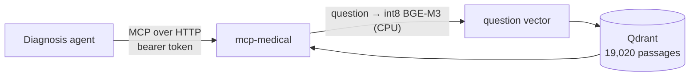

# Medical Knowledge MCP server

The only way RAGMed's agents reach the medical knowledge base. It exposes a small, fixed set of
read-only tools over [MCP](https://modelcontextprotocol.io) (streamable HTTP), so an agent can
search and read, and nothing else.



## What it offers

| Kind | Name | Does |
| --- | --- | --- |
| Tool | `search_medical_knowledge(query, top_k ≤ 10, qtype?)` | Best-matching passages, one per answer, with id, question, type, text and score |
| Tool | `get_passage(answer_id)` | One full answer |
| Tool | `list_topics()` | Question types and how many answers each has |
| Resource | `ragmed://dataset/card` | Source, licence, citation, size, embedding model, date indexed |
| Resource | `ragmed://disclaimer` | Text every answer must end with |
| Prompt | `grounded_answer(question, passages)` | Answer only from the passages, cite them, refuse when they do not answer, never give doses |
| HTTP | `GET /healthz` | Liveness check for Docker and UptimeRobot |

All tools are marked read-only. Arguments are validated: an empty query, more than 2,000
characters, `top_k` outside 1–10 or an unknown `qtype` is refused.

## Run it locally

From `backend/`, after `make install-bench`:

```bash
make export-onnx    # the int8 question encoder (once)
make search Q="test" # embeds the 19,020 passages once and caches the vectors (~10 min on a GPU)
make mcp-ingest     # loads passages + vectors into an embedded Qdrant in data/artifacts/qdrant (~10 s)
make mcp-serve      # http://127.0.0.1:9001/mcp
```

Without `RAGMED_SERVICE_TOKENS` the local server accepts any caller. To require tokens:

```bash
export RAGMED_SERVICE_TOKENS='{"diagnosis-agent": "<at least 32 random characters>"}'
```

Then call it with any MCP client, for example [MCP Inspector](https://github.com/modelcontextprotocol/inspector)
(`npx @modelcontextprotocol/inspector`), using the URL above and the token as a bearer token.

## Configuration

Environment variables (prefix `RAGMED_`), read by [`app.py`](src/mcp_medical/app.py):

| Variable | Default | Meaning |
| --- | --- | --- |
| `RAGMED_SERVICE_TOKENS` | none | JSON map of caller name to token. **Required in production**; the server refuses to start without it |
| `RAGMED_QDRANT_URL`, `RAGMED_QDRANT_API_KEY` | none | A Qdrant server. Without a URL, an embedded store in `RAGMED_QDRANT_PATH` is used |
| `RAGMED_QDRANT_PATH` | `data/artifacts/qdrant` | Folder for the embedded store |
| `RAGMED_COLLECTION` | `medquad` | Collection name |
| `RAGMED_ONNX_DIR` | `data/artifacts/onnx/BAAI__bge-m3` | The int8 export from `make export-onnx` |
| `RAGMED_HOST`, `RAGMED_PORT` | `127.0.0.1`, `9001` | Where to listen |

## Measured

On an Apple M4 Pro, 4 CPU threads: a search takes about 66 ms end to end over HTTP, of which
about 9 ms is embedding the question. Ingesting all 19,020 passages takes about 10 seconds.

## Not yet

- Per-tenant stores (`X-Tenant-Id`) for users who bring their own database: needs the accounts
  and approvals feature.
- A reranker, pending the reranking experiment.
- A Dockerfile, once Docker is installed for local testing.
