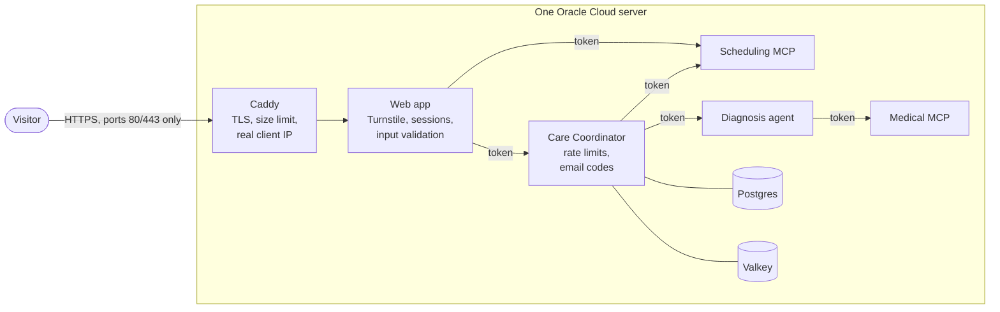

# Security audit

**System:** RAGMed Clinic, the live demo at [ragmed.bijanroudini.com](https://ragmed.bijanroudini.com)
**Date:** November 2026
**Performed by:** Bijan Roudini, with [Claude Code](https://claude.com/claude-code) (Anthropic) as
an AI pair reviewer: it read the code paths, ran the live probes and dependency scans listed below,
and implemented fixes that were then reviewed, tested and deployed.

RAGMed is a public demo that calls free-tier language models, sends real emails and books real
calendar slots, so it was audited before being shared widely. This document covers what was
tested, what was found, what was fixed, and the risks that remain. Secrets, addresses and other
sensitive details are deliberately left out.

**Contents:** [Summary](#summary) · [Threat model](#threat-model) · [Architecture](#architecture-as-deployed) ·
[Tests and results](#tests-and-results) · [Findings and fixes](#findings-and-fixes) ·
[Remaining risks](#remaining-risks) · [How to re-run](#how-to-re-run-the-checks)

## Summary

- **No known vulnerabilities** in the production Python or JavaScript dependencies (pip-audit,
  npm audit), and **no secrets** in the public Git history (gitleaks, all commits).
- Every live attack in the [test table](#tests-and-results) was refused, including forged
  sessions, spoofed client IP addresses, calls without service tokens and oversized requests.
- **Eight findings fixed**, the largest being an architectural one: the web app moved off a
  hosting account shared with another site, and the backend now has **no public address at all**.
- Remaining risks are operational (account security, free-tier changes) rather than in the code.

## Threat model

| Who | What they might try | Main defences |
| --- | --- | --- |
| Curious visitors (for example from a LinkedIn post) | Make the assistant say odd or harmful things; poke at the API | Topic routing, emergency screening on every message, "not a diagnosis" notices; strict request validation |
| Script users and bots | Burn the free model quota; flood the site | Cloudflare Turnstile, per-IP, per-conversation and demo-wide daily limits |
| Spammers | Use the clinic to email strangers or fill the calendar | Email verification before booking; per-address, per-IP and daily ceilings on code emails and bookings |
| Attackers after data | Read patients' names, emails or conversations | No public backend; per-link service tokens; long clinician access code; no raw HTML rendering |
| Attackers after the server or accounts | Break in, or pivot to other sites run by the same person | Minimal open ports, key-only SSH from one address, isolated hosting, automatic security updates |

Out of scope: physical and insider threats, the security of the third-party services themselves
(Oracle, Cloudflare, Groq, Google, Cal.com), and medical correctness, which is covered by the
evaluation work in the main README.

## Architecture as deployed



Only Caddy listens on the internet, and it serves only the web app. Every link between services
carries its own bearer token, and each service refuses to start in production without one.

## Tests and results

All tests were run against the live production site unless noted.

| Area | Test | Result |
| --- | --- | --- |
| Bot check | Send a chat message without a Turnstile token | Refused (403) |
| Sessions | Send a message with a forged session cookie | Refused (403) |
| Rate limits | Exceed the per-IP hourly message limit | Refused with a "try again in N minutes" message, before any model call |
| IP spoofing | Send a fake `X-Forwarded-For` / `X-Real-IP` to dodge per-IP limits | Ignored: the limit counted the real address |
| Service tokens | Call the Coordinator, clinician list and MCP endpoints without or with a wrong token | Refused (401) or not reachable |
| Exposure | Probe the backend's ports and paths from the internet | Closed; only the web app answers |
| Database | Connect to Postgres or Valkey from the internet | Closed |
| SSH | Password and keyboard-interactive login | Disabled; keys only, and only from one address |
| Request size | Send a 200 KB request | Rejected (413) |
| Clinician page | Wrong access code | Refused (401) |
| Booking abuse | Book in someone else's name; guess or reuse codes | Needs a 6-digit code sent to that address; 10-minute expiry, 5 tries, salted hash only |
| Browser hardening | Check response headers | CSP, X-Frame-Options, HSTS, nosniff, Referrer-Policy and Permissions-Policy all present; server software hidden |
| Rendering | Look for raw HTML rendering of model output | None; chat text is rendered as Markdown only |
| Prompt injection | Ask the assistant to ignore its instructions | It can only change what the reply says: the models have no tools that read other users' data or reach the server |
| Dependencies | pip-audit (production lock), npm audit (production) | No known vulnerabilities |
| Secrets | gitleaks over the full Git history | No secrets; 3 matches were medical text (false positives) |
| TLS | Certificate issuer and renewal | Let's Encrypt, renewed automatically by Caddy |
| Domain | Registrar lock | Transfer lock on |
| Recovery | Boot-time settings (Docker, firewall rules, restart policies, data volumes) | All set to come back after a reboot |

## Findings and fixes

| # | Finding | Risk | Fix |
| --- | --- | --- | --- |
| 1 | The web app shared a free hosting account with the author's portfolio site; a flood of traffic could use up that account's allowance and affect the other site | High (availability of another site) | Moved the web app onto the project's own server; the hosting account now serves only the portfolio |
| 2 | The backend had a public address (token-protected) | Medium | Removed: the web app reaches the backend only on the private Docker network |
| 3 | No ceiling on total model use: many IP addresses together could exhaust the shared free quota | Medium | Daily message ceiling for the whole demo, checked after per-visitor limits so blocked visitors do not use it up |
| 4 | No ceiling on total verification emails: many addresses could get the clinic's email account suspended for spam | Medium | Daily ceiling on code emails, far below the provider's sending limit |
| 5 | The agent card and other backend paths were publicly readable | Low | Superseded by fix 2; before that, Caddy exposed only the three paths the web app used |
| 6 | No browser security headers (clickjacking, MIME sniffing) | Low | Content Security Policy (scripts and frames only from the site and Turnstile), frame, referrer and permissions policies, HSTS |
| 7 | Short clinician access code with no attempt limit | Low | Replaced by a long random code (24+ characters; brute force is infeasible) |
| 8 | Bookings could be made with anyone's email address | High (abuse of real people's inboxes and calendars) | Email verification before booking, fixed during the same hardening work |

Earlier hardening that the audit confirmed: Turnstile with signed HTTP-only session cookies;
per-IP, per-conversation and per-IP booking limits in Valkey (failing open, with logging, so a
limiter outage cannot take the site down); emergency screening on every message; strict
validation of every button action; SSRF-safe URL checks for user-supplied endpoints; logs that
redact email addresses.

## Remaining risks

| Risk | Likelihood | Mitigation |
| --- | --- | --- |
| A personal account (code host, DNS, cloud, email) is taken over by phishing or a reused password | Low, but the highest impact | Two-factor authentication on every account; this matters more than any code fix |
| Free tiers change or run out during a traffic spike | Medium | Gemini backup models behind Groq; demo-wide daily ceilings end in a friendly message; uptime monitoring |
| The assistant says something wrong or embarrassing | Medium | Grounded answers with citations, "not a diagnosis" notices, emergency screening, topic routing |
| Visitors enter real health information into a demo | Medium | Planned: an on-page notice and automatic deletion of conversations and bookings after 7 days |
| Data loss on the single server | Low | Bookings also live in the calendar provider; planned: nightly backups to free object storage |
| Denial of service against the single server | Low | Caddy size limits and the Turnstile gate; the server is isolated from other sites, so the worst case is a slow demo |

## How to re-run the checks

```bash
# Dependencies
pip-audit -r backend/requirements/prod.txt   # (editable lines removed first)
(cd frontend && npm audit --omit=dev)

# Secrets in history
gitleaks git --redact .

# Live: refused without the bot check, health check, headers
curl -s -o /dev/null -w '%{http_code}\n' -X POST https://ragmed.bijanroudini.com/api/chat \
  -H 'content-type: application/json' -d '{"message":"hi"}'          # 403
curl -s https://ragmed.bijanroudini.com/api/health                    # {"status":"ok"}
curl -sI https://ragmed.bijanroudini.com | grep -iE 'content-security|x-frame|strict-transport'
```

Automated tests cover the same rules on every pull request: the backend suite (rate limits,
email codes, tokens, production start-up checks) and the browser suite (bot check, forged
sessions, request validation, health check).

To report a vulnerability, see [SECURITY.md](../SECURITY.md).
