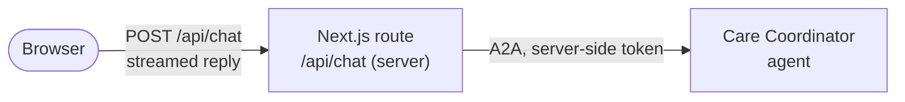

# RAGMed web app

The chat patients use. Next.js (App Router, TypeScript, Tailwind), deployed to Vercel.



The browser only ever talks to `/api/chat` on this app. That route calls the Care Coordinator
over A2A from the server, so the backend's address and token never reach the browser.

## What it shows

- Live progress while the agents work ("Searching the medical knowledge base…").
- The answer with its sources (MedQuAD questions it was built from) and a suggested next step.
- An urgency badge (self-care, see a clinician soon or today, emergency).
- A red emergency card when a message describes an emergency.
- Follow-up questions in the same conversation, and a "New conversation" button.

## Run it

The easiest way is the whole stack at once, from the repository root: `make demo`.

To run only the web app against a backend that is already running:

```bash
cp .env.example .env.local    # then edit if the Coordinator is elsewhere
npm install
npm run dev                   # http://localhost:3000
```

| Variable (server-side) | Default | Meaning |
| --- | --- | --- |
| `COORDINATOR_URL` | `http://127.0.0.1:8000` | The Care Coordinator agent |
| `COORDINATOR_TOKEN` | none | Bearer token for the Coordinator; required in production |

## Code map

| File | Purpose |
| --- | --- |
| `src/app/api/chat/route.ts` | Validates the message and streams events back as NDJSON |
| `src/lib/coordinator.ts` | Server-only A2A client: one `SendStreamingMessage` call, parsed from Server-Sent Events |
| `src/components/chat.tsx` | The chat interface |
| `src/lib/types.ts` | The reply and event shapes shared by the route and the interface |

`npm run lint` and `npm run build` (which type-checks) run in CI on every pull request.
